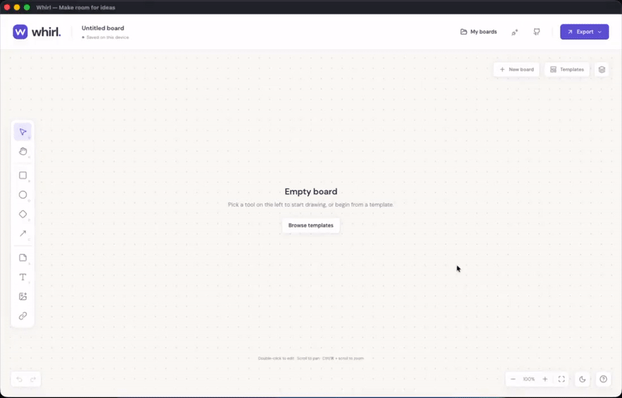
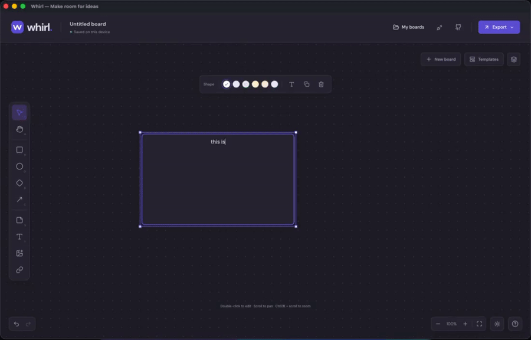
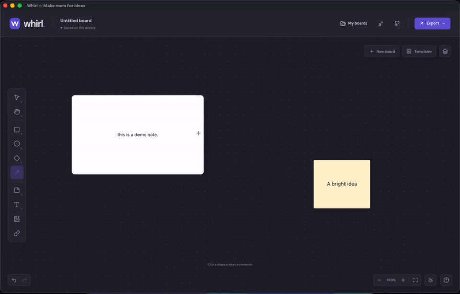
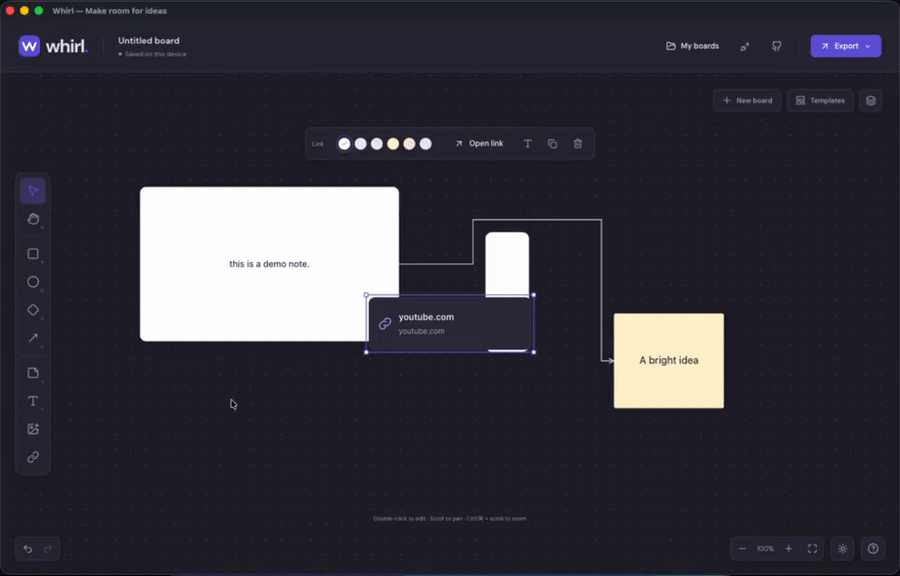

<div align="center">


<p>
  
  
  <a href="https://github.com/nsawill1405/whirl/actions/workflows/ci.yml"></a>
  <a href="LICENSE"></a>
</p>

<p><a href="#what-works-today">What works today</a> · <a href="#write-anywhere">Write anywhere</a> · <a href="#connectors-that-stay-attached">Connectors</a> · <a href="#links-and-references-on-the-board">Links</a> · <a href="#run-locally">Run locally</a> · <a href="#your-data">Your data</a> · <a href="#controls">Controls</a> · <a href="#ai-assistants-mcp">AI assistants (MCP)</a> · <a href="#desktop-app">Desktop app</a> · <a href="#development">Development</a> · <a href="#license">License</a></p>

</div>

**A little space for your next big idea.** A free, MIT-licensed, local-first whiteboard for structured diagrams and sticky notes. No account, no tracking, no paid tier.

Pick a tool, click or drag on the canvas, and a shape appears. Drag any corner to resize it — pull past the opposite edge and it flips. The floating toolbar restyles the selection: six palette colors, plus duplicate and delete. Everything works in light and dark themes.



## What works today

- Infinite canvas with pan, zoom, fit-to-content, and light/dark themes.
- Rectangles, ellipses, diamonds, sticky notes, text, and PNG/JPEG/WebP images, animated GIFs, and looping MP4/WebM/Ogg video (double-click or select and press Space to play/pause).
- Select, shift-select, box-select, move, resize from any corner (drag past the opposite edge to flip), recolor, duplicate, copy/paste, and undo/redo.
- Persistent groups: select shapes and group them to select, move, resize, copy, or export together.
- Attached orthogonal connectors that route around shapes, with editable labels.
- Multiple boards, IndexedDB autosave, and flowchart/retrospective templates.
- PNG, SVG, and editable `.whirl.json` exports; import boards and images.
- Responsive tools and keyboard-accessible layers for selecting objects.
- A desktop app for Windows, macOS, and Linux.
- An optional local MCP server so AI assistants (Claude, Cursor, and others) can read and edit the open board.

**This is the first local-first release, not a multiplayer service.** Real-time collaboration, mind-map mode, PDF export, and accounts are not implemented. The next milestone is Yjs sync with a small Node/WebSocket server and durable server-side storage. The browser editor does not need a server API today; the MCP server is optional.

## Write anywhere

Every shape doubles as a text container — double-click and start typing. Sticky notes come in the same palette as shapes, so a quick thought and a formal diagram node look right next to each other. Text, notes, and shapes can be selected, moved, grouped, and recolored together.



## Connectors that stay attached

Press `C`, click a source shape, click a target — the connector binds to both. It reroutes orthogonally around shapes as you drag things around, and you can double-click it to add a label. Connectors copy, delete, and export along with the shapes they join.



## Links and references on the board

Paste a URL and it lands as a link card with an "Open link" action in the toolbar — handy for keeping references beside the diagram they belong to. Images and videos embed the same way, so the board can hold the material you're thinking about, not just boxes and arrows.



## Run locally

Requires Node.js 22.12+ and npm.

```sh
npm install
npm run dev
```

Open the URL Vite prints (normally `http://localhost:5173`). For production:

```sh
npm run build
npm start
```

Or self-host with Docker:

```sh
docker compose up --build -d
```

Open `http://localhost:8080`. The production app is static, so you can also host `apps/web/dist` on any static web host. Fonts are bundled; there are no third-party network requests or analytics. There is no service worker in this release.

## Your data

Boards save to **this browser on this origin**, not to a cloud account. Give the “Saved on this device” indicator a moment before closing a tab. Different browsers, hostnames, and devices have separate boards. Export JSON backups before clearing browser data, changing hosts, or switching devices. Storage failures are shown in the header; private browsing can limit persistence. Do not edit the same storage from several tabs at once. Image imports are embedded in your board and limited to 12 MB per image (including GIFs); MP4/WebM/Ogg videos are embedded with a separate 25 MB per video limit.

To move a board, choose **Export → Whirl board**, then import the JSON through the image/import tool or My boards. JSON preserves shapes, connectors, text, and embedded images; SVG/PNG are presentation formats. There are import limits (3,000 shapes / 6,000 connectors) to prevent accidentally loading unreasonable files. Very large or dense diagrams can slow routing; use several boards for large projects.

## Controls

| Action | Shortcut |
| --- | --- |
| Select / pan | V / H (or Alt + drag) |
| Rectangle / ellipse / diamond | R / O / D |
| Sticky note / text | S / T |
| Connector | C, then click source and target |
| Edit text or arrow label | Double-click, or select and Enter |
| Finish editing / newline | Enter / Shift + Enter |
| Multiple selection | Shift + click, or drag a selection box |
| Group / ungroup selected shapes | Ctrl/⌘ G / Ctrl/⌘ Shift G |
| Undo / redo | Ctrl/⌘ Z / Ctrl/⌘ Shift Z |
| Copy / paste / duplicate | Ctrl/⌘ C / V / D (within Whirl) |
| Move selected objects | Arrow keys; Shift for larger steps |
| Delete | Delete / Backspace |
| Pan / zoom | Scroll / Ctrl/⌘ + scroll |
| Fit everything | 1 |

On touch screens, choose Pan to move the viewport; use the zoom buttons to zoom. Mobile editing is supported, but a mouse and keyboard are best for complex boards.

Use the selection bar's Group/Ungroup buttons or the shortcuts above. Clicking any member (including in Layers) selects its whole group; drag the shared bottom-right handle to resize it. Groups save with the board and JSON backups, and copies get independent groups. Grouping existing groups combines them into one flat group; ungroup before editing individual members. Choose **Export → Selection as PNG/SVG/JSON** to export just the selected group and its internal connectors without changing whole-board exports.

## AI assistants (MCP)

Whirl ships a [Model Context Protocol](https://modelcontextprotocol.io) server in `packages/mcp`. Your AI app starts it over stdio, and it listens on `ws://127.0.0.1:7331` for the Whirl tab. Boards still live only in your browser: the server relays tool calls to the open tab and keeps nothing.

```sh
npm install
npm run build:mcp
```

Add it to your MCP client, for example in Claude Desktop's `claude_desktop_config.json`:

```json
{ "mcpServers": { "whirl": { "command": "node", "args": ["/path/to/whirl/packages/mcp/dist/index.js"] } } }
```

Then open Whirl and click the plug icon in the header. A green dot means the assistant is connected; click it again to disconnect. Whirl remembers the choice.

Tools: `list_boards`, `open_board`, `create_board`, `rename_board`, `get_board`, `add_shapes`, `update_shapes`, `connect_shapes`, `update_connectors`, `delete_items`, `group_shapes`, `fit_view`, and `connection_status`. Assistant edits go through normal undo/redo.

The server only binds to `127.0.0.1` and only accepts `localhost`/`127.0.0.1` pages. Set `WHIRL_MCP_ORIGINS=https://your-whirl-host` to allow a self-hosted copy (your browser may ask to allow access to local devices), and `WHIRL_MCP_PORT` to change the port. If you change the port, run `localStorage.setItem('whirl.mcp.port', '<port>')` in the Whirl tab's console. Only one tab can be connected at a time; the newest tab wins.

## Desktop app

`apps/desktop` wraps the editor in [Electron](https://www.electronjs.org). It works offline and saves boards in the app's own storage, separate from any browser. Installers are built by the **Desktop** GitHub Actions workflow: open a run and download `Whirl-windows` (`.exe`), `Whirl-macos` (`.dmg`), or `Whirl-linux` (`.AppImage` and `.deb`). The builds are not code-signed yet, so Windows SmartScreen and macOS Gatekeeper warn the first time; on macOS, right-click the app and choose **Open**.

```sh
npm install
npm run desktop        # build and launch from source
npm run dist:desktop   # build an installer for this OS into apps/desktop/release
npm run test:desktop   # Electron smoke test
```

The desktop app includes the MCP server. Choose **Help → Copy AI Assistant (MCP) Setup**, paste the copied JSON into your AI app's MCP config, restart the AI app, then click the plug icon in Whirl. The AppImage moves each time it runs, so use the `.deb` (or the source checkout) for MCP on Linux.

## Development

`apps/web` is a React/Vite editor. `packages/scene` owns the portable scene model, geometry, validation, and connector routing. `apps/desktop` is the Electron shell. `packages/mcp` is the optional stdio MCP server and its WebSocket bridge to the editor. Rendering uses a high-DPI HTML canvas with viewport culling and cached routes; text editing uses an HTML overlay. There is no backend or secret configuration to set up.

```sh
npm run typecheck
npm test
npx playwright install chromium
npm run test:e2e
npm run build
```

CI runs these checks on pull requests. Playwright covers drawing and connecting objects, text, movement, history, duplication, local persistence, exports, invalid imports, templates, and mobile controls. There are no pre-commit hooks. Contributions are welcome: open an issue to discuss larger features, keep changes focused, and add a regression test for bug fixes.

## License

[MIT](LICENSE). Your boards are yours.

---

<div align="center">

<sub>Made by <a href="https://github.com/nsawill1405">William North</a> · <a href="https://nsawill.co.uk">nsawill.co.uk</a></sub>


</div>
